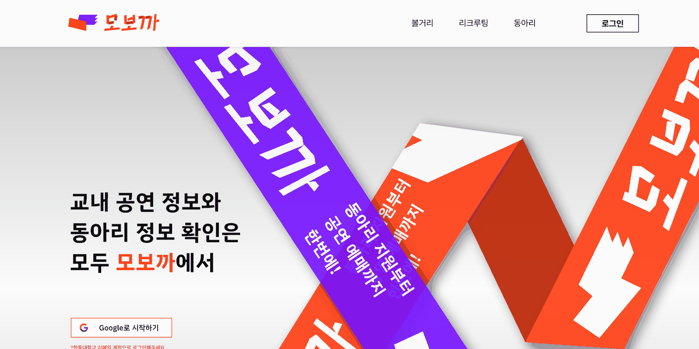
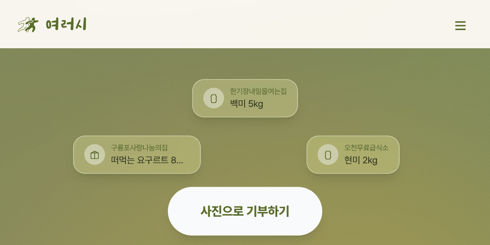
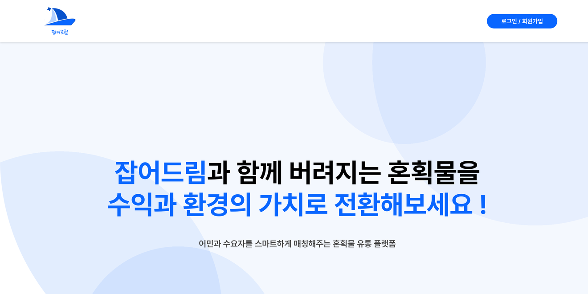
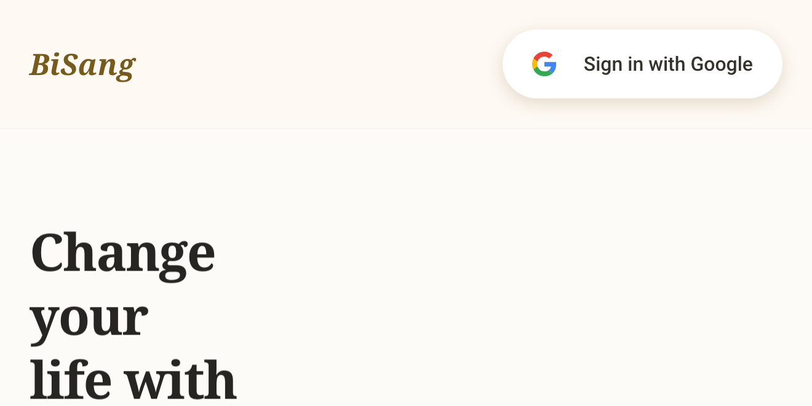
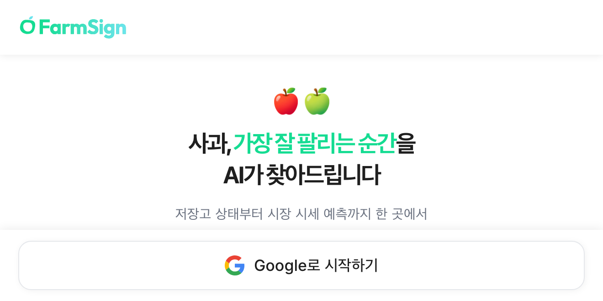

 

 

 

# 👋 안녕하세요, 김원진입니다

**✨ 일상의 작은 불편을, 직접 만든 서비스로 바꿉니다.**

React·TypeScript로 웹 서비스를 만들어요. AI·뇌파·로봇과 웹을 연결하는 일도 좋아합니다. 만들면서 부딪힌 문제와 해결 과정은 블로그에 차곡차곡 기록해요.

[블로그](https://lingard09.github.io) · [이메일](mailto:kinnwonjin@gmail.com) · [프로젝트 전체 목록](https://lingard09.github.io/project/)

## 🚀 함께 만든 대표 프로젝트

<table>
<tr>
<td width="50%" valign="top">

<h3><a href="https://github.com/MOBOGGA/MOBOGGA_Front">🎟️ 모보까</a></h3>

공연 예매 플랫폼

<strong>🥈 SW 페스티벌 최우수상</strong>

<strong>🛠️ 제가 맡았어요</strong> 로그인·인증 · 마이페이지 · 관리자 화면

예매 후 송금 안내·앱 연결·카카오톡 공유를 구현하고, SDK 로딩·오류 상태를 처리했습니다.

<code>React · Recoil · Zustand</code>

<a href="https://mobogga.netlify.app/">🌐 서비스 ↗</a> · <a href="https://github.com/MOBOGGA/MOBOGGA_Front">💻 코드 ↗</a>

🔎 코드로 보는 작업 기록

<ul><li><a href="https://github.com/MOBOGGA/MOBOGGA_Front/commit/cd1d13a3e6">관리자·마이페이지</a></li><li><a href="https://github.com/MOBOGGA/MOBOGGA_Front/commit/abc6b7dd60">송금·공유 개선</a></li></ul>

</td>
<td width="50%" valign="top">

<h3><a href="https://github.com/Estherdami-cmd/Sharing">🤝 여러시</a></h3>

사진으로 연결하는 나눔 매칭

<strong>🛠️ 제가 맡았어요</strong> 사진 인식 API · 유통기한 검증 · 품목 매칭

‘기한 없음’과 ‘판독 실패’를 분리해 추가 입력을 받고, AI 일반명과 문자열 규칙으로 품목을 매칭했습니다.

<code>Next.js · TypeScript · OpenAI</code>

<a href="https://sharing-khaki.vercel.app">🌐 서비스 ↗</a> · <a href="https://github.com/Estherdami-cmd/Sharing">💻 코드 ↗</a>

🔎 코드로 보는 작업 기록

<ul><li><a href="https://github.com/Estherdami-cmd/Sharing/commit/12678ff6e7">날짜 판독 개선</a></li><li><a href="https://github.com/Estherdami-cmd/Sharing/commit/3e8a32df49">품목 매칭 개선</a></li></ul>

</td>
</tr>
<tr>
<td width="50%" valign="top">

<h3><a href="https://github.com/LikeLionHGU/Karina_Front">🐟 잡어드림</a></h3>

혼획물을 자원으로 잇는 거래 서비스

<strong>🥇 AI커리어스쿨 LAUNCH 창업톤 대상</strong>

<strong>🛠️ 제가 맡았어요</strong> 역할별 홈 · 거래·매칭 화면 · API 연동

어민·공장별 화면과 메뉴를 분리하고, 거래 관리와 토큰 만료·로그아웃 예외 처리를 연결했습니다.

<code>React · TypeScript · styled-components</code>

<a href="https://jabeodream.netlify.app/">🌐 서비스 ↗</a> · <a href="https://github.com/LikeLionHGU/Karina_Front">💻 코드 ↗</a>

🔎 코드로 보는 작업 기록

<ul><li><a href="https://github.com/LikeLionHGU/Karina_Front/commit/691438c5ec">역할별 화면·API</a></li><li><a href="https://github.com/LikeLionHGU/Karina_Front/pull/47">토큰 만료 처리</a></li></ul>

</td>
<td width="50%" valign="top">

<h3><a href="https://github.com/EEGMeditation-HCI02/Bisang">🧘 Bisang</a></h3>

뇌파·자세 정보로 돌아보는 명상

<strong>🛠️ 제가 맡았어요</strong> 장비 연결 · 뇌파 파싱 · 자세 분석·리포트

고빈도 원시 패킷 대신 필요한 지표 수신 시 차트를 갱신하도록 바꾸고, 세션 분석 결과를 리포트에 연결했습니다.

<code>React · TypeScript · Web Serial · MediaPipe</code>

<a href="https://bi-sang.pages.dev/">🌐 서비스 ↗</a> · <a href="https://github.com/EEGMeditation-HCI02/Bisang">💻 코드 ↗</a>

🔎 코드로 보는 작업 기록

<ul><li><a href="https://github.com/EEGMeditation-HCI02/Bisang/pull/40">장비 연결 구현</a></li><li><a href="https://github.com/EEGMeditation-HCI02/Bisang/commit/6ebecc9004">차트 갱신 개선</a></li></ul>

</td>
</tr>
<tr>
<td width="50%" valign="top">

<h3><a href="https://github.com/LikeLionHGU/Aewonhaeseo-Front">💧 물어볼래</a></h3>

질문에서 원본 근거까지, 수질 데이터 분석

<strong>🛠️ 제가 맡았어요</strong> API 클라이언트 · 질문 파서 · 인증·배포 연동

질문을 분석 조건으로 변환하고, 배포 환경에서 API 대신 HTML이 반환되던 문제를 프록시와 응답 검증으로 처리했습니다.

<code>Vue 3 · TypeScript · Vercel · Cloudflare</code>

<a href="https://aewonhaeseo-front.vercel.app">🌐 서비스 ↗</a> · <a href="https://github.com/LikeLionHGU/Aewonhaeseo-Front">💻 코드 ↗</a>

🔎 코드로 보는 작업 기록

<ul><li><a href="https://github.com/LikeLionHGU/Aewonhaeseo-Front/commit/34e469bee6">질문 파서 구현</a></li><li><a href="https://github.com/LikeLionHGU/Aewonhaeseo-Front/pull/7">배포 API 연동</a></li></ul>

</td>
<td width="50%" valign="top">

<h3><a href="https://github.com/LikeLionHGU/HipApple_Front">🍎 팜사인</a></h3>

데이터로 판단하는 사과 출하 시점

<strong>🥇 경북 X AI 문제해결 해커톤 대상</strong>

<strong>🛠️ 제가 맡았어요</strong> 로그인·가입 분기 · 시장가격·예측 차트

신규 회원 여부에 따라 이동 경로를 분기하고, 실제 시세·7일 예측·예측 범위를 구분해 시각화했습니다.

<code>React · TypeScript · SVG</code>

<a href="https://hip-apple.vercel.app">🌐 서비스 ↗</a> · <a href="https://github.com/LikeLionHGU/HipApple_Front">💻 코드 ↗</a>

🔎 코드로 보는 작업 기록

<ul><li><a href="https://github.com/LikeLionHGU/HipApple_Front/pull/34">로그인 후 분기</a></li><li><a href="https://github.com/LikeLionHGU/HipApple_Front/commit/b9b4ddba1d">시세 예측·차트</a></li></ul>

</td>
</tr>
</table>

## 🏆 수상과 발자취

| 수상·선정 | 대회·사업 | 관련 프로젝트 |
| --- | --- | --- |
| 대상 | 구글 후원 AI커리어스쿨 LAUNCH 창업톤 | 잡어드림 |
| 대상 | 경북 X AI 문제해결 해커톤 · 한동대 산학협력단 | 팜사인 |
| 최우수상 | 2025 한동대 SW 페스티벌 · SW 전공부문 | 모보까 |
| 장려상 | 업스테이지 주관 AI Agent 해커톤 | — |
| 선정 | 2026 이노테크 지원사업 | 경제의 숲 |

- **💼 ZCELL 인턴** — 한동대 교수 창업기업 · 풀스택 개발, 호스팅, DNS.
- **🦁 멋쟁이사자처럼대학 한동대학교 14기 대표** — 프론트엔드 13기 수료.
- **📚 포항YMCA 지원 학습지원 플랫폼** — 학업위기청소년을 위한 시제품 제작.
- **🌳 경제퀴즈플랫폼** — 기획·PM·디자인·퍼블리싱.
- **🎖️ 군 복무** — 28사단 정보통신대대 영상음향장비운용병 만기 전역.

## 🔬 새로운 연결을 탐구해요

### 🦾 뇌파와 비전 AI로 움직이는 로봇팔

P300 기반 BCI로 선택한 객체를 YOLO·Depth 카메라의 3차원 좌표와 연결해 로봇팔의 Pick & Place 동작으로 이어가는 시스템입니다.

**🛠️ 제가 맡았어요 — Unity 통합 제어 및 MyCobot 320 연동**

- EEG 모듈의 객체 선택 결과와 비전 모듈의 좌표를 Unity에서 통합했습니다.
- 소켓 통신으로 로봇팔에 좌표를 전달하고 Pick & Place 경로를 생성·실행했습니다.
- P300 시각 자극 인터페이스와 객체별 target 분류 횟수에 따른 최종 대상 판정을 구현했습니다.

| 측정 항목 | 기록된 결과 |
| --- | --- |
| EEG 명령 → Unity 응답 | 평균 8.796 ms |
| 카메라–로봇 좌표 보정 | 대응점 10개 기반 최소자승 아핀 변환 · 평균 오차 9.4 mm |
| P300 분류 | Trial Accuracy 0.917 · AUC 0.747 |

위 수치는 각 측정 구간의 결과이며, 로봇팔의 전체 작업 완료 시간을 의미하지 않습니다.

**📝 2026 한국컴퓨터종합학술대회(KCC) 논문집 공저자** · 과기정통부 SW중심대학사업·한국연구재단 지원

`Unity` `C#` `OpenViBE` `YOLO` `RealSense Depth` `MyCobot 320`

[🎬 시연 영상](https://youtu.be/mIUh6lxgHxk)

## 🧰 작게 만들고, 꾸준히 기록해요

**[히즈넷 첨부파일 이름 복구](https://github.com/lingard09/HisnetKoreanFileNameFixer)** · `JavaScript` · `Browser Extension`

학교 첨부파일의 깨진 한글 이름을 다운로드 시점에 복구하는 확장입니다. Chromium 계열과 Firefox를 지원합니다. [만든 과정](https://lingard09.github.io/hisnet-filename-fixer/)

**[히즈넷 모바일](https://github.com/lingard09/hisnet-mobile)** · `React`
데스크톱 화면이 축소되어 보이던 학교 공지 목록을 모바일에서 읽기 좋게 바꾸는 북마클릿입니다. [만든 과정](https://lingard09.github.io/hisnet-mobile/)

**[PL2 웹사이트](https://github.com/lingard09/pl2-website)** · `HTML` `CSS` `JavaScript`
빌드 도구 없이 제작한 크리에이티브 스튜디오 정적 웹사이트입니다. [서비스](https://lingard09.github.io/pl2-website/)

**[로지스틱 성장 시각화](https://github.com/lingard09/biomath-logistic-2d)** · `HTML`
로지스틱 성장·수확 모델과 분기를 탐색하는 도구로, 의존성 없는 단일 HTML 파일로 동작합니다. [서비스](https://lingard09.github.io/biomath-logistic-2d/)

| 기술 글 | 다룬 문제 |
| --- | --- |
| [좌충우돌 대용량 영상 배포기](https://lingard09.github.io/video-hosting-detour/) | 134MB 영상 파일의 배포 방법 검토 |
| [히즈넷 모바일 버전 만들기](https://lingard09.github.io/hisnet-mobile/) | 모바일 화면이 없는 학교 시스템 개선 |
| [Floorp 주소창 붙여넣기 문제](https://lingard09.github.io/floorp-double-paste/) | 붙여넣기가 두 번 실행되는 브라우저 문제 조사 |

## 💻 함께 쓰는 기술들

- **⚡ 주로 사용하는 기술:** JavaScript, TypeScript, React.
- **🧪 프로젝트에서 사용한 기술:** Next.js, Vue, Unity, C#, OpenAI, Gemini, Firebase, Cloudflare, Vercel.

🧩 그 밖에 사용한 언어 · 도구

기존 프로젝트·학습에서 사용한 기술입니다.

- **언어:** Java, Python, Swift.
- **웹·데이터:** Vite, Electron, Spring Boot, FastAPI, Node.js, PostgreSQL, Supabase.
- **배포·운영:** AWS, Docker, GitHub Actions.
- **AI·자동화:** Claude, OpenAI, Ollama, n8n.
- **연구·디자인:** EEG(DSI-24), MATLAB, SWLDA, ROS2, Figma.

## 🌱 더 만든 것들

🗂️ 다른 프로젝트도 둘러보기

| 프로젝트 | 내용 | 기술 · 역할 | 링크 |
| --- | --- | --- | --- |
| 터움 | TourAPI 기반 전통 문화 여행 탐색·AI 맞춤 코스 | Firestore 기반 여정 보관함, TourAPI 프록시·엣지 캐시, AI 추천 설명의 장소 불일치 필터링 | [추천 설명 검증](https://github.com/lingard09/teoum/commit/3e32da1ffc) · [코드](https://github.com/lingard09/teoum) · [서비스](https://teoum.pages.dev) |
| 경제의 숲 | 레벨 테스트·일일 퀴즈·대결·그룹 랭킹을 제공하는 경제 학습 플랫폼 | 기획·PM·디자인·프론트엔드, 정적 다중 페이지 전환, 공용 퀴즈 데이터와 대결 흐름 구현 | [퀴즈·대결 구현](https://github.com/lingard09/ForestOfEconomy-Front/commit/65feabe3d3) · [코드](https://github.com/lingard09/ForestOfEconomy-Front) · [서비스](https://lingard09.github.io/ForestOfEconomy-Front/index.html) |

**[한카 · Hancar](https://github.com/lingard09/HanCar)** — 대학생 카풀 iOS 앱에서 Google·Firebase 인증, 카풀 생성·수정·신청, 내 카풀 목록과 프로필, Firestore·MessageKit 기반 채팅을 구현했습니다. [구현 기록](https://github.com/lingard09/HanCar/commit/ddae792750)

**[BrainRacing](https://github.com/lingard09/BrainRacing)** — 뇌파 입력을 활용하는 Unity 레이싱 게임에 참여했습니다. 맵·씬 구성, 콜라이더·물리 설정, 부스터 작업 기록이 있습니다. [작업 기록](https://github.com/lingard09/BrainRacing/commits?author=lingard09)

[프로젝트 전체 목록](https://lingard09.github.io/project/)

## 🐍 지나온 자리

<picture>
  <source media="(prefers-color-scheme: dark)" srcset="https://raw.githubusercontent.com/lingard09/lingard09/output/snake-dark.svg" />
  <source media="(prefers-color-scheme: light)" srcset="https://raw.githubusercontent.com/lingard09/lingard09/output/snake.svg" />
  
</picture>

  

<picture>
  <source media="(prefers-color-scheme: dark)" srcset="https://streak-stats.demolab.com/?user=lingard09&hide_border=true&disable_animations=true&date_format=Y.n.j&background=transparent&ring=667EEA&fire=764BA2&currStreakNum=667EEA&currStreakLabel=764BA2&stroke=30363D&sideNums=C9D1D9&sideLabels=8B949E&dates=8B949E" />
  <source media="(prefers-color-scheme: light)" srcset="https://streak-stats.demolab.com/?user=lingard09&hide_border=true&disable_animations=true&date_format=Y.n.j&background=transparent&ring=667EEA&fire=764BA2&currStreakNum=667EEA&currStreakLabel=764BA2&stroke=E5E5E5&sideNums=333333&sideLabels=666666&dates=999999" />
  
</picture>

 

